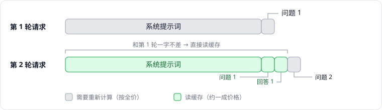

这一篇创业日志，想讲清楚一件很技术、但和钱直接相关的事：大模型的提示词缓存。

我们做的是一个 AI 助手。用户每发一句话，背后发给模型的，除了这句话本身，还有一份很长的系统提示词：它告诉模型自己是谁、有哪些工具可以用、应该遵守哪些规则，往往有一两万个 token。用户的那句话，可能只有几十个 token。

最近我们花了几天时间，想让不同用户之间也能共用这份系统提示词的缓存。做的过程中我发现，缓存这件事看起来简单，细节却非常多：各家模型的规则不一样，中间转发的平台又会再加一层规则，很多地方不亲自测一遍，根本想不到。所以我想借这篇文章，把它从头到尾理一遍。

## 01 大模型为什么要缓存

### 模型的大部分工作，是在「读」

我们向模型发一个请求，模型做的事情可以分成两步：

1. **读输入**：把我们发过去的全部内容，从第一个 token 开始，逐个处理一遍。
2. **写输出**：在读完的基础上，一个 token 一个 token 地生成回答。

第一步有个专门的名字，叫「预填充」（prefill）。模型每读一个 token，都会算出一份中间结果，留着给后面的 token 参考。这份中间结果通常被称为 **KV 缓存**。可以把它理解为模型读完这段内容后，记在脑子里的「笔记」。

对一个 AI 助手来说，输入往往比输出长得多：一两万 token 的系统提示词，加上越来越长的聊天记录，而回答可能只有几百个 token。所以无论从计算量还是从费用来看，大头都在「读」这一步。读得越多，用户等到第一个字出现的时间也越长。

### 每一轮，都要从头读一遍

大模型本身是不记事的。和它多轮对话时，每一轮都要把**之前的全部内容**再发一遍：

- 第 1 轮：系统提示词 + 问题 1
- 第 2 轮：系统提示词 + 问题 1 + 回答 1 + 问题 2
- 第 3 轮：再在后面接上回答 2 和问题 3

_第 2 轮请求的开头，和第 1 轮一字不差_

如果没有缓存，模型每一轮都要把这些内容从头读一遍，算出和上一轮一模一样的「笔记」。这显然是浪费。

**提示词缓存**做的事情很简单：模型读完一次请求后，供应商把这份「笔记」存一段时间；下一个请求来了，如果开头和之前的某个请求完全一样，这一段就不用再读了，直接拿存好的笔记，接着往后读新的部分。

### 为什么必须是「开头一样」

这里有一个后面所有章节都会用到的关键点：**缓存只能复用开头的部分，而且必须一字不差。**

原因在于模型读输入的方式。模型处理每个 token 时，都会参考它前面的所有内容。所以第 100 个 token 的笔记，不只取决于这个 token 本身，还取决于前面那 99 个 token。前面哪怕改了一个字，后面所有的笔记都会跟着变，存好的那份就不能用了。

反过来，只要从开头到某个位置的内容完全相同，这一段的笔记就一定相同，可以放心复用。所以缓存只看一件事：**从开头到某个位置，是不是一字不差。** 中间相同、结尾相同都没有用。

> 这也意味着，缓存能不能命中，很大程度上取决于我们怎么组织请求的内容。把会变化的内容放在前面，后面再长也复用不了。

### 缓存省下了什么

缓存省的是两样东西。

第一样是**首字延迟**。读过的部分不用再读，模型能更快开始输出，用户等第一个字的时间会明显变短。

第二样是**钱**。用了缓存之后，输入大致会按三种价格收费：

| 模型 | 普通输入 | 写入缓存 | 读取缓存 |
| --- | --- | --- | --- |
| Claude（5 分钟缓存） | 1 | 1.25 | 0.1 |
| GPT-5.6 及以后 | 1 | 1.25 | 0.1，部分型号 0.05 |
| Gemini 3.8 Flash（自动缓存） | 1 | 不另收费 | 0.1 |
| DeepSeek（经 OpenRouter） | 1 | 1 | 0.1 |

表里以普通输入的价格为 1，数字来自各家 2026 年 11 月的文档，具体以官方价格为准。

可以看到，「写入缓存」往往比普通输入还贵一点，因为供应商要额外占用存储；但「读取缓存」只要一成甚至更少。所以缓存划不划算，取决于存下来的内容之后能被读多少次。

拿一个典型的多轮对话算一笔账：系统提示词 15,000 token，每一轮问答让对话增加 1,000 token，一共聊 20 轮。按 Claude 的价格：

- **没有缓存**：每一轮都按全价读完整个对话，20 轮加起来，相当于 51 万个 token 的全价费用。
- **有缓存**：第 1 轮按写入价存下来；之后每一轮，前面的内容按一成价格读取，只有新增的 1,000 token 按写入价存一次。20 轮加起来，大约相当于 9 万个 token 的全价费用。

**同样的对话，输入费用只剩不到两成。** 这就是为什么做 AI 应用的人都在意缓存。

不过，缓存不是「打开开关就自动生效」的东西。它在哪里命中、能不能命中，取决于请求怎么组织、怎么发送，各家模型的规则也不一样。下一章，我们先把「命中」这件事拆开讲清楚。
