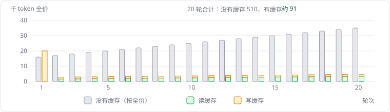
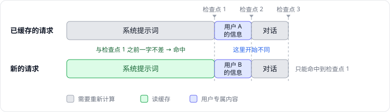
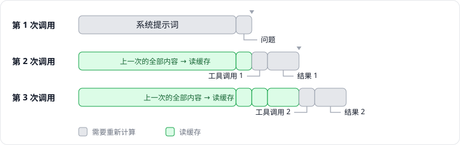
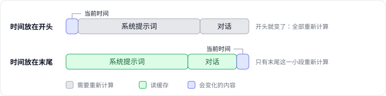
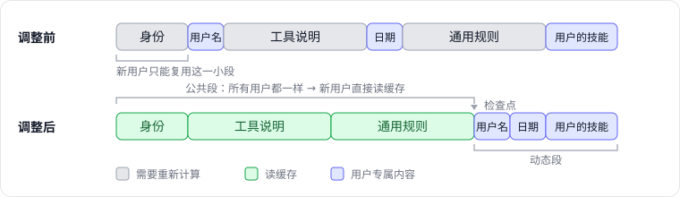
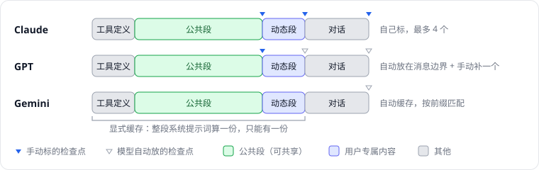
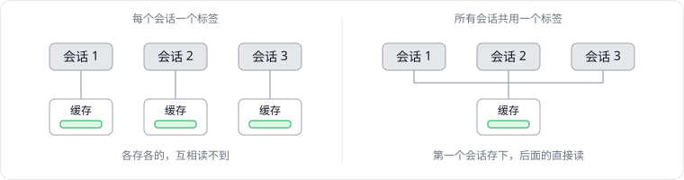
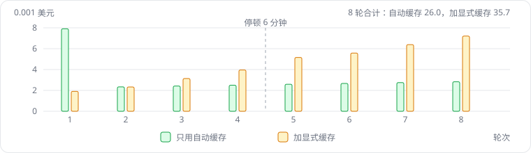
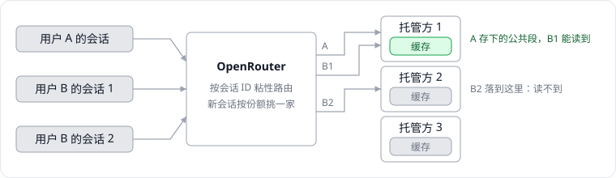

这一篇创业日志，想聊一件很技术、但和钱直接相关的事：大模型的提示词缓存。

我们做的是一个 AI 助手。用户每发一句话，背后发给模型的，除了这句话本身，还有一份很长的系统提示词：它告诉模型自己是谁、有哪些工具可以用、应该遵守哪些规则，往往有一两万个 token。用户的那句话，可能只有几十个 token。

最近我们花了几天时间，想让不同用户之间也能共用这份系统提示词的缓存。做的过程中我发现，缓存这件事看起来简单，细节却非常多：各家模型的规则不一样，中间转发的平台又会再加一层规则，很多地方不亲自测一遍，根本想不到。所以我想借这篇文章，把它从头到尾理一遍。

## 01 大模型为什么要缓存

### 模型的大部分工作，是在「读」

我们向模型发一个请求，模型做的事情可以分成两步：

1. **读输入**：把我们发过去的全部内容，从第一个 token 开始，逐个处理一遍。
2. **写输出**：在读完的基础上，一个 token 一个 token 地生成回答。

第一步有个专门的名字，叫「预填充」（prefill）。模型每读一个 token，都会算出一份中间结果（主要是两组叫作 Key 和 Value 的数字），留着给后面的 token 参考。这些中间结果合起来叫作 **KV 缓存**。计算时它们放在 GPU 的显存里；要留到下一个请求再用，供应商可能把它们存在显存、内存，甚至 SSD 上。可以把 KV 缓存理解为模型读完这段内容后，记下的「笔记」。

对一个 AI 助手来说，输入往往比输出长得多：一两万 token 的系统提示词，加上越来越长的聊天记录，而回答可能只有几百个 token。所以无论从计算量还是从费用来看，大头都在「读」这一步。读得越多，用户等到第一个字出现的时间也越长。

### 每一轮，都要从头读一遍

大模型本身是不记事的。和它多轮对话时，每一轮都要把**之前的全部内容**再发一遍：

- 第 1 轮：系统提示词 + 问题 1
- 第 2 轮：系统提示词 + 问题 1 + 回答 1 + 问题 2
- 第 3 轮：再在后面接上回答 2 和问题 3

_第 2 轮请求的开头，和第 1 轮一字不差_

如果没有缓存，模型每一轮都要把这些内容从头读一遍，算出和上一轮一模一样的「笔记」。这显然是浪费。

**提示词缓存**做的事情很简单：模型读完一次请求后，供应商把这份「笔记」存一段时间；下一个请求来了，如果开头和之前的某个请求完全一样，这一段就不用再读了，直接拿存好的笔记，接着往后读新的部分。

### 为什么必须是「开头一样」

这里有一个后面所有章节都会用到的关键点：**缓存只能复用开头的部分，而且必须一字不差。**

原因在于模型读输入的方式。模型处理每个 token 时，都会参考它前面的所有内容。所以第 100 个 token 的笔记，不只取决于这个 token 本身，还取决于前面那 99 个 token。前面哪怕改了一个字，后面所有的笔记都会跟着变，存好的那份就不能用了。

反过来，只要从开头到某个位置的内容完全相同，这一段的笔记就一定相同，可以放心复用。所以缓存只看一件事：**从开头到某个位置，是不是一字不差。** 中间相同、结尾相同都没有用。

> 这也意味着，缓存能不能命中，很大程度上取决于我们怎么组织请求的内容。把会变化的内容放在前面，后面再长也复用不了。

### 缓存省下了什么

缓存省的是两样东西。

第一样是**首字延迟**。读过的部分不用再读，模型能更快开始输出，用户等第一个字的时间会明显变短。

第二样是**钱**。模型厂商的定价通常分几项：输入按 token 收费，输出也按 token 收费，单价往往是输入的好几倍。支持缓存的模型，会把输入再细分成两种价格：写入缓存和读取缓存。

以 Claude 为例，把普通输入的价格记为 1：

- **写入缓存是 1.25**：第一次把一段内容存进缓存时，要比普通输入多付 25%，因为供应商要额外占用存储；
- **读取缓存是 0.1**：之后的请求再用到这段内容，只要一成的价格。

其他厂商的具体数字各有不同，但思路基本一样：存的时候不便宜，读的时候很便宜。所以缓存划不划算，取决于存下来的内容之后会被读多少次。

拿一个典型的多轮对话算一笔账：系统提示词 15,000 token，每一轮问答让对话增加 1,000 token，一共聊 20 轮。按上面 Claude 的价格：

- **没有缓存**：每一轮都按全价读完整个对话，20 轮加起来，相当于 51 万个 token 的全价费用。
- **有缓存**：第 1 轮把内容写进缓存；之后每一轮，前面的内容按一成价格读取，只有新增的 1,000 token 按写入价存一次。20 轮加起来，大约相当于 9 万个 token 的全价费用。

_每一轮的输入费用，以 1,000 个 token 的全价为单位_

从图里可以看到，第 1 轮有缓存反而更贵一点，因为写入缓存要多付 25%。但从第 2 轮开始，前面的内容都按一成价格读取，每一轮的费用几乎不再随着对话变长而增加。

**同样的对话，输入费用只剩不到两成。** 这就是为什么做 AI 应用的人都在意缓存。

不过，缓存不是「打开开关就自动生效」的东西。它在哪里命中、能不能命中，取决于请求怎么组织、怎么发送，各家模型的规则也不一样。下一章，先把「命中」这件事拆开来看。

## 02 缓存怎样才算命中

上一章说，缓存只能复用开头的部分，而且必须一字不差。这一章把这句话拆开，看看一次命中背后还有哪些条件：缓存存在哪些位置、能存多久、存在哪里、谁能用。

### 只在「检查点」上存

供应商不会在每一个 token 的位置都存一份缓存，那样太占地方。它只在一个请求里的几个位置存，我们不妨把这些位置叫作**检查点**：存下的是「从开头到这个检查点」为止的那份笔记。

下一个请求进来时，供应商也只在这些检查点上比对：从开头到某个检查点，新请求和之前的请求是否一字不差。一致就命中，这一段直接读缓存；从这个检查点往后，照常重新计算。如果有好几个检查点都能对上，就用最靠后的那个，命中得最多。

_新请求从「用户信息」开始和之前不同，只能命中到检查点 1_

所以，命中多少不只取决于内容相同的部分有多长，还取决于**这段相同内容的末尾，恰好有没有一个检查点**。如果图里检查点 1 不存在，新请求的系统提示词虽然和之前一字不差，也一个 token 都读不到缓存。这一点在后面讲「让不同用户共享缓存」时会非常关键。

检查点放在哪里，各家的做法分两种：

- **自动**：供应商自己决定。比如较新的 GPT 模型，会在最新一条用户消息的末尾、开头那组系统消息的末尾这类「消息边界」上存；有的模型则是每隔一段固定长度存一次。
- **手动**：开发者在请求里自己标出位置，供应商照着存。Claude 就是这样，一个请求里最多标 4 个，这些标记通常被称为「缓存断点」。

另外，缓存还有一个最小长度：从开头到检查点的内容太短，就不会存。这个门槛各家不同，常见的是几百到几千个 token。系统提示词一般都远超这个长度，所以多数时候不用担心。

### 能存多久

缓存不会一直留着。每家都有一个有效期，过了时间没人用，就会被清掉。

以 Claude 为例，默认有效期是 5 分钟，而且**每命中一次，就重新计时**；如果愿意多付一点写入费用，也可以把有效期延长到 1 小时。其他家的有效期从几分钟到几小时不等，也有的写明「尽力而为」，不保证一定还在。

这意味着，一段内容只要被频繁使用，它的缓存就几乎一直有效；反过来，一个用户聊完一轮，隔了半小时再回来，前面的缓存多半已经过期，要重新写一遍。

### 存在哪里，谁能用

缓存存在供应商自己的机器上：显存、内存，或者 SSD。这带来两个容易被忽略的条件。

第一个条件是，**请求要被送到存着缓存的那台机器上**。大的供应商有成千上万台机器，一份缓存只在其中一部分机器上。所以供应商在分配请求时，会尽量把开头相同的请求送到同一组机器上，但这不是保证，命中本身也是「尽力而为」的。

第二个条件是，**请求要属于能看到这份缓存的那个范围**。缓存永远不会在不同的账号（组织）之间共享，A 公司存下的缓存，B 公司不可能读到。在同一个账号内部，有的供应商还允许开发者再加一个分组标签，把缓存进一步隔开，比如按客户分开。

> 这两个条件，平时都藏在供应商内部，直连的时候基本不用管。但如果请求中间还经过一层转发平台，事情就会复杂很多，后面会专门讲。

### 怎么知道有没有命中

最直接的办法，是看每次请求返回的用量统计。支持缓存的接口，都会在用量里单独列出「这次有多少 token 是从缓存里读的」，有的还会列出「这次写进缓存多少 token」。比如 OpenAI 风格的接口叫 `cached_tokens`，Claude 的接口叫 `cache_read_input_tokens` 和 `cache_creation_input_tokens`。

用这两个数，除以这次请求的总输入，就能算出命中率。后面我们判断一个优化有没有效果，看的都是这个数，而不是凭感觉。

到这里，命中的条件就都齐了：**开头一字不差、末尾有检查点、缓存还没过期、请求落到了对的机器上，而且属于同一个可见范围。** 下一章，我们用这些条件看一个最常见的场景：同一个会话里的多轮对话。

## 03 一个会话里的缓存

先看最常见的场景：同一个用户，在同一个会话里一轮一轮地聊。这个场景下，缓存几乎是「天然」命中的，前提是不要亲手把它打破。

### 为什么天然能命中

回到上一章的条件：开头一字不差、末尾有检查点。

多轮对话恰好满足第一条。每一次请求，都是「上一次请求的全部内容」再接上新增的一小段，所以上一次请求整个都是这一次的开头。

第二条也不难满足。自动缓存的模型，会在最新消息的末尾自己留检查点；手动缓存的模型，开发者通常会把断点打在最后一条消息上，每轮跟着往后挪一格。这样，每一次请求都能读到上一次请求留下的全部内容，只需要计算新增的部分。

对 AI 助手来说，这件事比普通聊天更重要。用户问一个问题，agent 往往要连续调用模型好几次：先决定调用什么工具，拿到工具结果后再决定下一步，最后才给出回答。每一次调用，都是在上一次的基础上接上「工具调用 + 工具结果」。

_一个问题背后的三次调用：每次都读缓存，只算新增的部分_

所以，一个会话里请求的次数，往往远多于用户说话的次数。在我们的系统里，一个会话调用模型十几次是很常见的事，会话内这些后续调用，大部分输入都能从缓存读取。会话内的缓存，是整笔账里最大的一块。

### 哪些做法会悄悄打破它

会话内的缓存很稳，但也很脆：**只要前面有一个字节变了，从那个位置往后就全部要重新计算。** 下面这些情况都很常见，而且出问题时不会报错，只会体现在账单上。

**1. 开头放了会变的东西。** 最典型的是在系统提示词里写「当前时间」，精确到分钟甚至秒。每次请求的时间都不一样，开头就不一样，整个请求都命中不了。

_同样一段「当前时间」，放的位置不同，结果完全不同_

解决办法是把会变的内容放到后面，或者降低它的变化频率，比如只写到「日期」，一天才变一次。随机生成的 ID、每次都重新计算的统计数字，也是同样的道理。

**2. 改写了历史。** 删掉早期的几条消息、把很长的工具结果截短、把旧图片换成文字描述，这些做法都能缩短上下文，但都会改动「开头」的一部分，从被改的那条消息开始，后面全部失效。如果确实需要改写历史，最好放在缓存反正已经过期的时候做，比如用户停顿了很久之后；并且一旦改了，后续请求要一直沿用改过的版本，不要来回变。

**3. 工具列表变了。** 很多模型的请求里，工具的定义排在系统提示词的前面。会话中途新增或移除一个工具，或者工具的描述、顺序变了，后面所有内容都会失效。

**4. 序列化不稳定。** 内容「看起来」一样，字节却不一样：JSON 的字段顺序变了、多了一个空格、一个列表是按读取文件的顺序排的而不是按名字排的。我们就遇到过：系统提示词里的技能列表，顺序取决于文件系统返回的顺序，在不同机器上可能不一样。对缓存来说，这和内容变了没有区别。

**5. 中途换了模型。** 缓存是按模型分开的，换一个模型，前面的缓存全部用不上。

**6. 压缩了上下文。** 对话太长时，常见的做法是把前面的内容总结成一段摘要，替换掉原来的历史。这是必要的，但压缩之后，历史从头变了，缓存要整个重建。所以压缩不宜太频繁。

**7. 停顿太久。** 用户离开的时间超过了缓存的有效期，回来时前面的缓存已经过期，第一个请求要重新写一遍。这一条通常无法避免，只能心里有数。

还有一些和具体模型有关的细节，比如有的模型要求后续请求原样带上之前的「思考过程」，丢掉或改写它，也会让缓存失效。这些放到后面讲各家差异时再说。

> 一个简单的自查办法：把同一个会话里连续两次请求的原始内容存下来，逐字节比较前一次请求是不是后一次请求的开头。如果不是，从第一个不同的位置，就能找到问题出在哪里。

做到这些，会话内的缓存基本就稳了。但它有一个天然的边界：**每个会话的开头，都没有缓存可读。**

设想一个新用户打开应用，只发了一句「你好」。这两个字只有几个 token，但这次请求里还带着完整的系统提示词，比如 15,000 个 token。这是会话的第一个请求，前面没有任何缓存可读，15,000 个 token 要全部计算一遍，还要按写入价存进缓存，比普通输入还贵 25%。

于是一句「你好」，花的是将近两万个 token 的全价费用。而同一个会话的第二轮，前面的内容都能按一成价格读取，同样的系统提示词只要一千五百个 token 左右的费用。**一个会话里最贵的，往往就是第一句话。**

更可惜的是，这份系统提示词的大部分内容，对所有用户其实都是一样的：模型的身份、可用的工具、要遵守的规则。可每一个新会话、每一个新用户，都要把它从头算一遍、再写一遍缓存。用户越多、会话越短，这部分浪费就越明显。

下一章就来讲，怎么让不同用户、不同会话共用这部分缓存。

## 04 让不同用户共享缓存

目标很明确：用户 A 的请求存下的缓存，用户 B 的第一句话也能读到。回到第二章的命中条件，要做到这一点，需要同时满足三件事：

1. **公共内容放在最前面，而且对所有用户一字不差**；
2. **公共内容的末尾，有一个检查点**；
3. **A 和 B 的请求，落在能共享缓存的同一个范围里**。

第三件事和具体的模型、转发平台有关，放到后面两章讲。这一章先解决前两件，它们对所有模型都适用。

### 先看系统提示词里都有什么

一份系统提示词，通常是程序按顺序拼出来的：先写模型的身份，再插入当前用户的名字，接着是工具说明，然后是今天的日期，再往后是通用规则，最后附上这个用户自己安装的技能……写的时候按「逻辑顺序」组织，很自然，但从缓存的角度看，公共内容和用户专属内容是**穿插**在一起的。

_同样的内容，换一种排列，新用户能复用的部分完全不同_

穿插的后果，第二章已经说过：缓存只能复用到「第一个不同的位置」之前。第一处用户专属内容出现得越早，所有用户能共用的部分就越短。

### 第一步：把提示词分成两段

做法是把整份系统提示词重新排列成两段：

- **公共段**：对同一个版本的所有用户都一样的内容，比如模型的身份、工具说明、通用规则、内置技能的介绍；
- **动态段**：随用户、随会话、随时间变化的内容，比如用户名、用户的偏好和记忆、当前日期、工作目录的路径、用户自己安装的技能、回答使用的语言。

两段之间用一个固定的分隔标记隔开，公共段在前，动态段在后。

分的时候，最容易拿不准的是一类「看情况变化」的内容：只随模型变化的规则（比如「当前模型能不能看图」），只随功能开关变化的说明，只随操作系统变化的提示。我们的判断是：**它们留在公共段原来的位置就好。** 缓存本来就是按模型分开的，工具集合不同、功能开关不同的请求，本来也很难共用；把这些内容挪到后面，换不来任何缓存上的好处，反而打乱了提示词原本的逻辑顺序。真正要挪的，只是那些**同样配置下、不同用户之间会不一样**的内容。

### 几个实用的小技巧

有些内容表面上是动态的，其实可以拆开：说明留在公共段，具体的值放进动态段。

**用引用代替具体的值。** 比如搜索工具的说明里写着「『最近』指 2026-10-29 之后」，这个日期每天都变。可以改成「『最近』指动态段里 `sevenDaysAgo` 之后」，然后在动态段里列出 `sevenDaysAgo: 2026-10-29`。说明对所有人都一样，每天变的只有动态段里的一行。

**用变量代替用户自己的路径。** 比如「记忆保存在 `/Users/alice/agent/memory`」，路径里带着用户名。可以改成「记忆保存在 `${AGENT_ROOT_DIR}/memory`」，再在动态段里写明 `${AGENT_ROOT_DIR}` 的实际值。

> 这里有一个容易漏掉的坑：模型有时会原样照抄占位符，把 `${AGENT_ROOT_DIR}/memory` 直接传给工具。所以**工具在执行前要能自己把变量展开**，不能只依赖模型替换。我们就漏过一个工具，结果模型照抄时，记忆搜索会悄悄地什么都查不到。

**固定顺序。** 凡是列表，都按名字排序，不要依赖文件系统、数据库或哈希表返回的顺序。

### 第二步：在公共段末尾放一个检查点

内容排好了，还要让供应商在公共段的末尾存一份缓存。第二章说过，没有检查点，内容再一致也读不到。

这一步各家模型的做法不一样：有的要开发者手动标出位置，有的只认消息的边界，有的根本没有办法在消息中间放检查点。下一章会逐个讲。这里只需要记住：**排列好内容只完成了一半，检查点放对位置是另一半。**

### 别忘了工具定义

很多模型的请求里，工具定义排在系统提示词的**前面**。所以「公共前缀」实际上是「工具定义 + 公共段」，工具定义也必须对所有用户一字不差。

如果不同用户能用的工具不一样，比如有的用户开通了生成图片，有的没有，他们的请求从工具定义开始就不同了，会自然分成几组，每组内部各自共享。这通常可以接受，只要组数不多。真正要避免的，是工具定义里混进了用户专属的内容，比如在工具描述里写上用户名，那就每个用户各成一组，等于没有共享。

### 效果

做完这两步，再看上一章那句「你好」。

在我们的实测里，换一个账号、换一个用户，新会话的第一个请求，大约八成的输入可以直接从缓存读取，只有动态段和那句「你好」需要重新计算。按 Claude 的价格算，这一个请求的输入费用，从原来接近两万个 token 的全价，降到了四千个 token 左右。

> 调整提示词的顺序，还有一件事要留意：内容的位置变了，模型的理解和表现也可能跟着变。比如某条规则原来紧挨着它要约束的内容，挪走之后作用就可能变弱。所以改完之后，除了看缓存命中率，也要看模型的行为有没有变化。

不过，「在公共段末尾放一个检查点」这句话，说起来简单，在不同的模型上却有完全不同的做法，有的模型甚至做不到。下一章就来看各家模型的差异。

## 05 各家模型的差异

上一章的两步里，「排列内容」对所有模型都一样；真正因模型而异的，是第二步：**怎么在公共段的末尾放一个检查点。** 这一章看三家最有代表性的模型：Claude、GPT 和 Gemini，最后再说说其他模型。

_三家模型放检查点的方式各不相同_

### Claude：自己标，最多 4 个

Claude 不会自己决定在哪里缓存。想用缓存，要么在请求里自己标出检查点，也就是「缓存断点」，一个请求最多 4 个；要么打开请求级的自动缓存开关，让它缓存到请求的末尾。

这反而让事情变得直接：在公共段的末尾标一个，问题就解决了一半。剩下的是怎么分配这 4 个名额。我们的分配是：

1. **公共段末尾**：所有用户共享；
2. **动态段末尾**：同一个用户的不同会话共享；
3. **对话的最后一条消息**：每轮往后挪，保证会话内一路命中；
4. **留给请求级的「自动缓存」开关**：它会自动缓存到请求的末尾，作为兜底。

还有一个细节：Claude 的请求里，工具定义排在系统提示词前面。原本很多框架会在工具定义的末尾也标一个断点，但公共段末尾的断点已经覆盖了工具定义，这个断点就可以省下来，把名额让给动态段。

另外有两个容易踩的坑：

- **有的请求本来就不该缓存**，比如把对话压缩成摘要的那次请求，用一次就扔。如果代码不分情况，统一给每个请求加上缓存标记，这类请求就会白白多付写入的钱。
- **工具调用之后的请求，要原样带上之前的思考过程。** 如果开启了「思考」，Claude 要求后续请求原样保留它之前的思考内容和签名，丢掉或改写，不但缓存失效，请求还可能直接出错。

做完这些，在我们的实测里，新用户第一句话约 **82%** 的输入读缓存。

### GPT：只在消息边界上找，还要管「分组」

GPT 有自动缓存，什么都不做，同一个会话里就能命中。但要让不同用户共享，有两道坎。

**第一道坎：检查点只在消息的边界上。** 较新的 GPT 模型（GPT-5.6 及以后），自动缓存只在几个固定的位置存：最新一条用户消息的末尾、开头那组系统消息的末尾等。公共段和动态段都在同一条系统消息里，公共段的末尾不在任何一个边界上，自然不会在那里存。

> 有意思的是，更早的 GPT 模型不是这样，它们按固定长度（比如每 2,048 个 token）存一次，公共段多半能被自然覆盖到。模型升级之后，规则变了，原来「顺便」能共享的缓存，反而不共享了。

解决办法是手动补一个检查点。GPT 也支持在内容块上标「显式断点」，和 Claude 的思路一样。如果是经 OpenRouter 调用，甚至不用换写法：在公共段的内容块上标和 Claude 一样的 `cache_control`，OpenRouter 会把它转换成 OpenAI 的断点（`prompt_cache_breakpoint`）。注意 GPT 一个请求最多写 4 处缓存，自动缓存自己会占掉 1 处。

**第二道坎：分组标签。** GPT 的请求里有一个可选字段 `prompt_cache_key`，可以理解为缓存的「分组标签」：标签相同的请求共享缓存，标签不同就各存各的。

_分组标签决定了缓存放进哪个「抽屉」_

问题在于，这个标签常常被**默认填成会话 ID**。我们用的 agent 框架，直连 OpenAI 时就会把会话 ID 填进去；经 OpenRouter 调用时，如果请求里没有填，OpenRouter 也会按会话 ID 给缓存分组（这一点 OpenRouter 的文档没有直接写，是我们从实验结果推断出来的）。初衷是好的：会话之间互相隔离，更安全。但结果就是每个会话一个抽屉，A 存下的公共段，B 根本看不到。

这一点我们是用实验确认的：发几个**一字不差**的请求，只让会话 ID 不同，新会话的命中率是 0%；把会话 ID 改成相同，或者干脆不带，命中率立刻变成 99%。

所以 GPT 要同时做两件事：

1. 在公共段末尾补一个显式断点；
2. 在请求里**主动填一个所有用户共用的 `prompt_cache_key`**，不让它被默认填成会话 ID。

两件都做到，新用户第一句话约 **81%** 的输入读缓存；只做其中一件，都是 0%。

> 共用一个标签会不会有安全问题？缓存永远不会跨账号共享，标签只是在同一个账号内部再分组。我们的断点只打在公共段上，动态段是每个人自己的，别人要撞上这部分缓存，得事先知道完全相同的内容，风险很低。

**关于价格。** GPT-5.6 及以后，写入缓存要多付 25%。这笔钱其实一直在付：自动缓存每次都会把整个请求写一遍，只是写进去的内容只有这个会话自己能用。改了之后，新会话只需要写自己的动态段，公共段改成按一成价格读取，总的费用是下降的。

### Gemini：自动缓存反而更好

Gemini 有两套缓存：

- **自动缓存**：和其他自动缓存的模型一样，按前缀匹配，会把整个上一次请求都缓存进去，包括不断变长的对话；
- **显式缓存**：开发者主动建一份缓存，之后的请求引用它。

照着前面的思路，我们自然会想用显式缓存，在公共段末尾标一个断点。但测下来，这条路走不通，原因有两个。

第一，Gemini 的显式缓存**只能有一份**，而且它把整段系统提示词当成一个不可拆分的整体。我们的系统提示词里带着动态段，所以每个用户建出来的缓存都只属于自己，根本共享不了。

第二，显式缓存**只覆盖到断点为止**。断点在系统提示词里，后面越来越长的对话就不在缓存里，每一轮都要按全价重新计算。而自动缓存会把对话也一起缓存进去。

_同一个 8 轮对话，Gemini 两种缓存方式每轮的输入费用（实测）_

实测的 8 轮对话里，加显式缓存只在第 1 轮便宜，从第 3 轮开始就越来越贵，8 轮合计反而**多花了 37%**。第 4、5 轮之间我们故意停了 6 分钟：显式缓存的有效期是 5 分钟，到期不续，第 5 轮要重新写一遍；自动缓存则还在。

> 还有一个容易误判的地方：加了显式缓存后，账单上第 1 轮显示「几乎全部命中」，看起来很美。但仔细看会发现，这一轮写入了多少，就读取了多少：缓存是这次请求自己刚建、马上自己读的，并没有读到别人的。真正的共享，是 B 读到 A 存下的内容。

所以对 Gemini，我们的结论是：**保持自动缓存，什么都不加。** 以现在的提示词结构，Gemini 做不到跨用户共享系统提示词。理论上，可以把动态段从系统提示词里挪到第一条用户消息里，让所有人的系统提示词完全一样，但这会改变所有模型看到的提示词结构，为了一家模型不值得。

### 其他模型

DeepSeek、Kimi、GLM、MiniMax、Grok 这些模型，基本都是自动缓存，按前缀匹配。对它们来说，**上一章的第一步就够了**：把动态内容挪到后面，公共段就会自然成为共同的前缀，不需要额外标断点。

但我们实测时发现，它们跨会话的命中率很不稳定：有时八成以上，有时是零。问题不在模型，而在请求中间经过的那一层转发平台。这是下一章的内容。

### 小结

| 模型 | 检查点怎么来 | 要共享系统提示词，需要做什么 | 实测：新用户第一句话 |
| --- | --- | --- | --- |
| Claude | 只能手动标，最多 4 个 | 在公共段末尾标一个断点 | 约 82% 读缓存 |
| GPT（5.6 及以后） | 自动，只在消息边界 | 公共段末尾补显式断点，再共用一个分组标签 | 约 81% 读缓存 |
| Gemini | 自动按前缀；显式缓存只能一份 | 以现在的结构做不到，保持自动缓存 | 不适用 |
| 其他自动缓存模型 | 自动按前缀 | 把动态内容挪到后面即可 | 取决于转发平台 |

## 06 中间层带来的影响

前面讲的规则，都是模型供应商自己的规则。但很多 AI 应用并不直接调用 OpenAI 或 Anthropic，而是经过一层聚合平台，最常见的就是 OpenRouter：一个接口，就能调用几百个模型，还能在某家出问题时自动切到别家。

我们也是这样：用户的请求先到我们自己的转发服务（做鉴权和计费），再到 OpenRouter，最后才到真正运行模型的那家公司。中间每多一层，缓存就多一层变数。

### 同一个模型，有好几家托管方

在 OpenRouter 上，同一个模型往往由好几家公司在提供服务，OpenRouter 管它们叫 provider，这里叫「托管方」。比如 Claude 可以来自 Anthropic 自己，也可以来自亚马逊或谷歌的云平台；一个开源模型，背后可能有五六家不同的托管方。

缓存存在托管方自己的机器上。**不同托管方之间，缓存是不通的。** 一个请求落在托管方 1，存下的缓存，另一个落在托管方 2 的请求读不到。

### 粘性路由：一个会话固定在一家

OpenRouter 知道这一点，所以它做了「粘性路由」：请求里带一个会话 ID（`session_id`，或者请求头 `x-session-id`），同一个会话的请求就会一直发到同一家托管方，直到这个会话 10 分钟没有新请求为止。这样，会话内的缓存就能稳定命中。

> 如果不带会话 ID，OpenRouter 会拿「第一条系统消息 + 第一条用户消息」算一个哈希，当作会话的标识，而且要等观察到一次缓存命中之后，才开始粘住。对我们来说，系统提示词里有每个用户自己的动态段，这个哈希本来就因人而异，所以不带会话 ID 换不来跨用户共享，反而会让会话的前几轮在不同托管方之间漂移。**会话 ID 应该带上。**

但粘性路由只管「同一个会话」。**每一个新会话落到哪家托管方，OpenRouter 是按各家的份额挑的。** 用户 A 的会话落在托管方 1，存下了公共段的缓存；用户 B 的新会话如果也落在托管方 1，就能读到；落在托管方 2，就读不到。

_两个会话只有恰好落到同一家托管方，才能共享缓存_

所以经过 OpenRouter 时，跨会话、跨用户的缓存命中，多少带点运气：托管方越多、份额越平均，两个会话撞上同一家的概率就越低。

### 实测：命中与否，看落到了哪一家

第五章最后说，DeepSeek、Kimi 这些自动缓存的模型，跨会话的命中率很不稳定。把每个请求实际落到的托管方也记下来，原因就清楚了：

| 模型 | 测试中遇到的托管方数 | 新会话落到同一家时 | 落到别家时 |
| --- | --- | --- | --- |
| MiniMax M3 | 3 | 83%–85% | 1%–2% |
| GLM 5.3 | 4 | 82%–86% | 0% |
| DeepSeek V4.1 Flash | 6 | 66% | 0% |
| Kimi K3 | 3 | 0% | 0% |

表里的百分比，是新会话第一个请求里读缓存的比例。

MiniMax 和 GLM 很典型：落到同一家，八成以上命中；落到别家，就是零。Kimi 是个例外：即使落到同一家，新会话也没有命中，可能是那家托管方本身就按会话隔离缓存，我们没有再深究。

作为对照，Claude 和 GPT 在测试里基本都落在同一家托管方上，所以命中率很稳定。

### 平台还会改动你的请求

除了路由，聚合平台还会在「翻译」请求时，改变缓存相关的字段。几个我们遇到或在文档里看到的例子：

- **字段转换**：给 GPT 的内容块标 Claude 风格的 `cache_control`，OpenRouter 会转换成 OpenAI 的断点，这是好事。但在我们的链路上，直接用 OpenAI 原生的 `prompt_cache_breakpoint` 字段，请求反而失败了。
- **分组**：第五章说过，请求里没有分组标签时，OpenRouter 会按会话 ID 给 OpenAI 的缓存分组。
- **只认最后一个断点**：给 Gemini 标多个断点，OpenRouter 只用最后一个。
- **默认不缓存**：有的模型在 OpenRouter 上必须显式标 `cache_control` 才会缓存，比如阿里的部分 Qwen 模型，不标就完全不缓存，连会话内都不命中。

这些规则散落在不同的文档里，有的根本没写。**最可靠的办法，是用真实请求测一遍。**

### 我们是怎么测的

为了得到上面这些数字，我们写了一个专门的测试工具，用真实请求、真实账号去测。几个关键的设计：

1. **两个账号扮演两个用户**：A 和 B 用不同的账号、不同的用户信息，模拟真正的跨用户场景。
2. **固定的请求顺序**：A 的会话 1 发两轮，A 新开会话 2 发一轮，B 的会话 1 发两轮，B 再新开两个会话各发一轮。这样一组请求，就能同时看到「会话内」「同一用户跨会话」「跨用户」三种情况。
3. **每组请求加一个随机前缀**：在系统提示词最开头放一个随机字符串，每一组都不一样，避免读到之前测试留下的缓存，把结果搞乱。
4. **改动前后对比**：同一套请求，分别用改动前和改动后的代码各跑一遍，有的模型再加一种「补断点」的方案。
5. **完全走真实的代码路径**：系统提示词用产品里真实的拼装函数生成，请求经过和用户一样的转发链路，只是把用户的消息换成「只回复 OK」，让输出尽量短。
6. **记录每个请求的细节**：读缓存多少、写缓存多少、普通输入多少、耗时，以及平台返回的实际托管方和费用。

测的过程中也踩过几个坑，比如测试工具一开始没有完全模拟客户端的请求，被服务端当成了不合规的请求，直接返回了一句提示，根本没调用模型，用量统计里自然什么都没有；又比如 Gemini 显式缓存的用量统计里，同一批 token 同时出现在「读」和「写」里，按常规算法对不上账。**测试工具本身也要先验证，再相信它给出的数字。**

### 能不能干脆指定托管方

既然命中与否看落到哪一家，一个自然的想法是：在请求里指定只用某一家托管方，所有会话都落到同一家，跨用户命中就稳定了。OpenRouter 也支持这样做（`provider.order`）。

但这是有代价的：

- 指定了顺序，OpenRouter 的粘性路由就不再生效；
- 那家托管方出问题时，可以切换的备选变少；
- 各家的价格、速度、稳定性不同，选之前要先比较。

我们最后没有这样做。原因不在技术上，而在账算不过来，下一章细说。

## 07 值不值得做

前面几章一直在讲「怎么做」。回过头看，其实在动手之前，更应该先问一句：**这件事能省多少？**

### 能省的，只是第一句话

会话内的缓存，本来就能命中。跨用户共享缓存，省下的只是**每个会话第一个请求**里，公共段的那一部分。

所以它值多少，很大程度上取决于产品本身的形态：

- 用户多、会话短，比如很多人进来问一两句就走，第一个请求占的比重就大，省下的就多；
- 会话长，比如一个人在一个会话里连续工作一下午，第一个请求只是几十个请求中的一个，省下的就少。

这件事没有通用的答案，要看自己的数据：把「会话第一个请求」单独拎出来，看它占了多少输入、分布在哪些模型上，命中率是多少。我们看下来，会话第一个请求的费用只占总费用的一小部分，而且高度集中在少数几个模型上。于是做法也就很清楚了：用量最大的模型认真做；用量很小的模型，即使跨会话的命中率不稳定，也不值得为它去指定托管方、牺牲可用性。

说实话，以我们现在的规模，这笔钱不算大。它更大的价值，一是随着用户变多会越来越明显，二是新会话的第一句话，读缓存之后首字延迟也会变短，而第一句话，恰恰是用户对产品的第一印象。

### 几点体会

做完这件事，我最大的感受有三点。

**缓存首先是请求结构的问题，其次才是配置的问题。** 能不能命中，看的是请求里每一个字节怎么排列：什么放在前面，什么放在后面，哪里有检查点。在开头放一个时间戳，比任何配置错误的影响都大。

**每家的规则都不一样，而且文档常常不全。** Claude 要自己标断点，新版 GPT 只认消息边界、还会被一个默认的分组标签挡住，Gemini 的显式缓存只能有一份；再加上中间平台的路由和字段转换，很多行为文档里根本没写。真正可靠的，只有用真实请求一个一个测出来的数字。

**先算账，再动手。** 我们花在「怎么做」上的时间，远多于花在「值不值得做」上的时间。如果一开始就把数据拆开看，很多弯路可以不走，也能更早地决定哪些模型不必折腾。

## 写在最后

这件事最开始只是一个很朴素的想法：系统提示词对所有用户都差不多，能不能共用一份缓存？

真正做下来才发现，每一步都藏着细节：缓存只在检查点上存；新版 GPT 换了放检查点的方式，还会因为一个默认填上的分组标签，让所有努力归零；Gemini 的显式缓存在账单上看起来全部命中，其实一点都没共享；同一个开源模型背后有五六家托管方，命中与否要看运气。这些东西，文档里有的写了，有的没写，有的写了但和实际不一样。

如果没有一个一个地用真实请求去测，我们大概会在 Gemini 上打开显式缓存，然后看着账单上漂亮的命中率，以为自己省了钱。

在创业公司做技术，很多时候没有时间把一件事研究透。但缓存这种直接关系到成本和体验的事情，值得花几天，亲手把它摸清楚。
